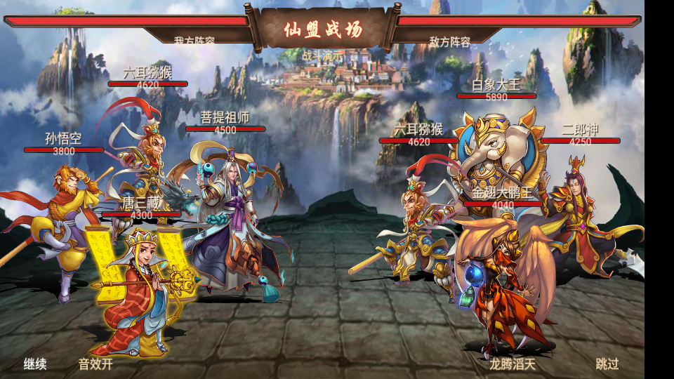
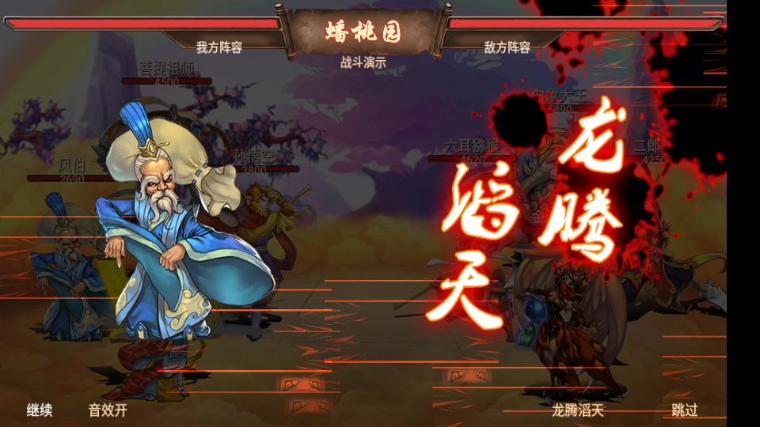

# 战斗模块逆向与还原（2026-10-21）

## 结论与证据边界

原游戏不是逐帧操作角色的即时格斗，而是**服务端计算战报，客户端依次演出**。角色主体是透明立绘；呼吸、蓄势、突进、旋转、放大、残影与击退由 Cocos2d-x 动作实现，刀光、水龙、墨迹等用 CocosBuilder 的 `.ccbi` 动画及 PNG／plist 图集播放。没有从两张静态截图推断骨骼动作。

本次读取 APK 1061 与本项目已保存的 1263 更新资源，并对照已反编译的原 Lua 脚本。`battle.py` 可重复生成 `.runtime/local_game/battle.json`，记录技能分类、原素材路径、音效时间表、关卡场景、演示战报，以及源资源版本和 SHA-256。原包与原渠道版不修改。完整导出：[战斗逆向数据.json](../outputs/battle-20261021/战斗逆向数据.json)。

**已经还原的是原素材、四站位布局、战报播放结构及核心演出。服务端伤害公式没有取得，不能称为原服全部战斗机制的逐帧、逐数值复刻。** 33 组原技能脚本的主要施法／命中 CCBI 已映射到新播放器；复杂技能的全部原轨迹、随机散布、状态联动尚未逐项移植。以下区分可确认规则和本地实现。

## 两张参考图的资源对应

| 画面元素 | 原资源／对应关系 |
|---|---|
| 第一张仙山、云海、石台 | `map/special/xmz.jpg`，直接使用整张原画 |
| 仙盟战场题字 | `map/special/xmz.png` |
| 蟠桃园场景、题字 | `map/special/pty.jpg`、`map/special/pty.png` |
| 顶部木牌和血槽框 | `v2/fightUI/gate_name_bkg.png` |
| 双方总血量 | `v2/fightUI/blood_big.png`，右侧镜像 |
| 角色头顶血槽 | `v2/fightUI/blood_char1.png`、`blood_char2.png` |
| 第二张施法人物 | **风伯**，`chars/4/4_20.png` |
| 技能名称 | 原配置名为 **龙腾滔天**，ID **104**；图中艺术字使用 `skill/name/104.png` |
| 红黑墨迹 | `blood_5.ccbi`／`blood_5_inv.ccbi`，图集 `blood_5/blood_5.png` |
| 横向速度线、爆气 | `splash_eye.ccbi`、`splash_light.ccbi` |
| 水龙施法、落点 | `123_1.ccbi`、`123_2.ccbi`／`123_2_1.ccbi` |
| 普攻刀光 | `204_1.ccbi`／`204_2.ccbi` |
| 死亡消散 | `106_1.ccbi` |
| 飘字与音乐 | `number/all_number_white.fnt`、`music/fight.mp3` |

风伯的原生技能其实是 ID 208“三头六臂”。参考图表现其释放 104，不能由此改写角色基础配置。单独的“龙腾滔天”演示为风伯指定 104；实际本地战斗默认读伙伴原生技能；在包裹装备主动法术后使用该法术，卸下恢复原生技能。演示使用固定阵容与加长生命值，方便观察，不属于玩家拥有的角色或装备，不写入存档。

第一张演示选择孙悟空、菩提祖师、六耳猕猴、唐三藏，对阵二郎神、六耳猕猴、白象大王、金翅大鹏王；不复制截图中的账号、血量或资产。实际关卡读自己的队伍与战报。第一张部分角色的造型或进阶形态无法仅凭截图完全确认，未用猜测覆盖玩家角色立绘。

## 战斗消息与执行链

`common/msg_def.lua` 可确认：

- 请求 `msg_fight_request = 1026`：`serial_num, fight_type, des_value, des_type, des_id`。
- 战报 `msg_fight_result = 1027`：`serial_num, fight_id, fight_type, guide_stage, final_result, fight_round, fight_result[]`。
- 阵容消息 `msg_fight_lineup = 1028`。
- 每条攻击记录包含 `self_use, skill_type, is_src, result, src_order, des_order, damage_count, damage_list[]`。

`fightUI.showFightDetailStepByStep → showSingleAttackEffect_private → skill_mgr.showSkill → skill_<id>.showSkill → CChar.beAttack → 下一步回调` 构成演出链。

`is_src` 决定进攻方；普通伤害指向另一队。ID 6 被明确识别为治疗，目标属于施法者所在队伍。`skill_base.csv` 的 `use_mode` 区分主动／被动，`effect_target` 区分单体／群体。群攻遍历对面仍在场的角色，治疗遍历己方；被动技能有独立状态处理流程，不能当作普通主动大招播放。

`skill_mgr` 对没有专属脚本的技能有回退路径，群攻回退到 101；原单体回退会在 202–209 间随机选择。本地播放器为可重复演出固定回退到 202，技能名称仍保留实际名称。

客户端还有护盾、反击、复活、额外伤害、增益和战斗事件分支，但缺少原服务器及完整装备／技能成长状态，不能仅靠展示代码得出触发概率、先手算法、暴击公式、仙缘加成或三星判定。配置中的 `formula`、`party_formula` 是公式编号，不是公式表达式；`use_probability` 的实际服务端处理也未验证。

## 布局、遮挡与动作

`common/constants.lua` 给出四个交错位置（归一化坐标，左下为原点）：

| 位置 | 我方 x / 脚底 y | 敌方 x / 脚底 y | 遮挡层 |
|---|---|---|---|
| 1 外侧 | .10 / .20 | .90 / .20 | 1200 |
| 2 内侧 | .35 / .20 | .65 / .20 | 1200 |
| 3 后排 | .23 / .35 | .77 / .35 | 1100 |
| 4 前排 | .22 / .05 | .78 / .05 | 1300 |

原索引 5–8 重用这四组坐标，不能据此断言所有玩法都只允许四名角色。本地版把可出战上限从三人扩到四人，并保留原存档已有阵容。

`CChar` 使用 `scaleH = .57 × 立绘高度 / 512`，再按屏高缩放；我方与敌方相互镜像。姓名位于头顶上方 .06 屏高，血条位于 .03 屏高，总血槽位于约 .925 屏高。客户端使用 960×540 逻辑画布，在设备实际分辨率上缩放；4:3 参考截图与当前宽屏的最终占比存在屏幕比例差异。

普攻依据 `skill_1_new.lua` 的结构：残影蓄势 → 向目标突进 → 倾斜挥击和方向刀光 → 命中飘字／受击变色 → 返回原位。受击通过短促位移和旋转完成，死亡后播放消散并隐藏姓名、血条和角色。

高品质或群攻大招依据 `skill.lua`：暗幕 → 施法立绘放大 → 墨迹与速度线 → 原书法技能图放大收束 → 施法 CCBI → 目标特效 → 血量变化。原脚本采用 `.044` 秒为部分轨道单位；新播放器使用独立时间轴，不宣称每项缓动都与原脚本逐帧相同。104 依据原脚本的三组四落点结构播放三波水龙，落点用固定偏移保证重放一致；生命值只按战报结算一次。

## 本地规则与持久化

`combat.py` 生成确定性战报，`service.py` 负责校验关卡、体力、阵容和事务结算：

- 玩家队伍先行动，每轮按队伍顺序攻击，死亡角色不再行动，最多 30 回合。
- 普攻：`max(1, round(攻击 − 防御 × .45))`。
- 每第三回合发动本地强化行动：主目标攻击系数 1.45；有主动原生技能则播放该技能。原生技能为被动的伙伴执行“蓄力一击”，**没有假冒触发被动大招，也尚未实现其属性加成**。
- 原配置标为群攻的主动技能攻击所有存活敌人；首目标使用完整强化系数，其他目标再乘 .55。
- 治疗 6 为存活且受伤的己方恢复 `round(攻击 × .8)`，不超上限、不复活；无人受伤时改为攻击。
- 每个事件包含 `hits[]`，每个命中有目标、伤害和命中后生命。旧单目标字段仍保留，便于兼容旧战报。
- 伤害系数、发动周期、治疗量、回合上限和先手方式均为**本地规则**，不是从原服还原出的计算公式。
- 2 体力消耗、银两、经验、首通翻倍及请求幂等保持原有流程。战斗请求成功时已结算，跳过、重放和中途返回只影响演出，不再次发送战斗请求。

包裹已接入本地装备技能槽及已装备法术的攻防生命被动加成；主动法术升级后，攻击系数每级增加0.05。尚未接通原服完整的法力、仙缘、反击、护盾、复活、复杂技能事件、星级评价、竞技场和仙盟玩法。详见 [包裹规则](INVENTORY.md)。现有十个本地关卡已使用新播放器；其余旅途关卡仍按 `JOURNEY.md` 的边界提供资料预览。

## 操作与构建

- **首页 → 阵容 → 右下“战斗演示”**：查看仙盟石台四对四；不消耗资源。
- 演示右下 **“龙腾滔天”**：直接查看第二张参考图对应的风伯施法。
- **旅途 → 已开放关卡 → 开战**：播放真实本地战报。
- 左下可暂停／继续、开关音效；右下跳过。结束后可重放或返回关卡，安卓返回退出战场。
- 背景音乐与技能声效读取原资源，默认开启，开关在当前客户端会话保留。

```sh
python3 scripts/build_local_game.py
python3 manage.py install
.runtime/venv/bin/python -m unittest discover -s tests -p 'test_*.py'
```

构建打包 `local_battle.lua`、`local_battle_data.lua` 并校验依赖。修改 Python 服务代码后需重启本地游戏服务；单纯覆盖安装 APK 不会让已运行的 Python 进程重新加载代码。

验证截图、日志、独立技能加载场景、源存档备份和验收记录保存在 `.runtime/local_game/battle-validation/`。这些文件中的演示数据与测试数据库不作为正式玩家存档使用。

## 本次验收

46 项自动测试通过。原引擎批量加载 38 个主动技能的双方演出，共 76 组；另用正式玩家状态的副本在隔离数据中验证第一关战报。最终 APK 脚本与源码一致，已覆盖安装，临时资源覆盖已清空，本地服务已重启为 `local-v2`。最终客户端日志没有脚本错误。

实机检查四对四、风伯施法、水龙命中、血量与死亡、暂停／继续、跳过、重放及暂停时安卓返回。前后对比确认银两、经验、角色、阵容、通关记录、解锁关卡与战斗次数未变化。验收明细：[validation.json](../.runtime/local_game/battle-validation/validation.json)。




